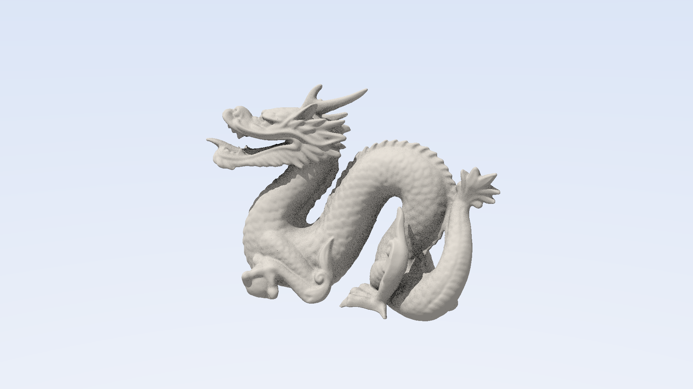

# BVH Ray Tracing of Large Triangle Meshes: Sequential CPU vs CUDA

Parallel Computing (CUDA) term project. Pitipol Tangcherdchar.

This project renders 3D-scanned triangle meshes with up to about a million triangles. Each pixel
casts one **primary ray**, one **shadow ray** toward a directional light, and *N* **ambient-occlusion
(AO) rays**. Each ray has to find its closest (or any) hit among all the triangles. A
**binned-SAH bounding volume hierarchy (BVH)** brings that down from O(T) to about O(log T) per
ray. The program compares a tuned single-threaded CPU baseline against four CUDA kernel versions
that all use the *same* BVH, camera, rays and random numbers, so their outputs can be checked
against each other pixel for pixel.



## Dataset

[Stanford 3D Scanning Repository](http://graphics.stanford.edu/data/3Dscanrep/):

| Model | File | Triangles | Format |
|---|---|---|---|
| Bunny | `bun_zipper.ply` | 69,451 | ASCII PLY |
| Dragon | `dragon_vrip.ply` | 871,414 | ASCII PLY |
| Happy Buddha | `happy_vrip.ply` | 1,087,716 | ASCII PLY |
| Lucy *(optional)* | `lucy.ply` | ~28M | binary PLY |

`graphics.stanford.edu` could not be reached from the development machine, so the download
script falls back to an unmodified copy of the original PLY files in the
[Harvey Mudd CS155 model archive](https://www.cs.hmc.edu/courses/2009/fall/cs155/archive/models/).
**Lucy is only on the Stanford server**, so as the plan allows, the largest model in the reported
results is the **Happy Buddha** (1.09M triangles). If you can reach Stanford, run the script with
`-Lucy` / `--lucy` and the benchmark script picks it up automatically (`--up z`). Lucy needs
about 1.8 GB of GPU memory and about 4 GB of host RAM.

A procedural sphere-on-ground scene (20K triangles) is built into the program for unit tests and
`--verify`, so neither needs a download.

## Requirements

| | Used for the reported results |
|---|---|
| GPU | NVIDIA GeForce RTX 2060 6 GB (Turing, sm_75, 30 SMs) |
| CUDA | 13.3 (any CUDA ≥ 11 should work; CUDA 13 needs sm_75 or newer) |
| Host compiler | MSVC 19.51 (Visual Studio 2026); GCC/Clang with C++17 on Linux |
| CMake | ≥ 3.24 (VS ships one), Ninja |
| CPU | Intel Core i7-9700F @ 3.0 GHz (baseline uses one core) |
| OS | Windows 10 Pro 22H2 |
| Plots | Python 3 + matplotlib (`py -m pip install matplotlib`) |

The only third-party code is `include/stb_image_write.h` (public domain, PNG output). There is
no OptiX, Embree or other ray-tracing library: the BVH, traversal and intersection code is all
hand-written.

## Build

The GPU architecture defaults to `native` (the GPU in the build machine). Override it with
`-DCMAKE_CUDA_ARCHITECTURES=75` (or 86, 89, …) when building for a different GPU.

**Windows** (finds Visual Studio, loads its x64 environment, then runs CMake + Ninja):

```powershell
powershell -ExecutionPolicy Bypass -File scripts\build.ps1
```

Manual build from a *x64 Native Tools* prompt:
`cmake -S . -B build -G Ninja -DCMAKE_BUILD_TYPE=Release` then `cmake --build build`.

**Linux:**

```bash
cmake -S . -B build -DCMAKE_BUILD_TYPE=Release && cmake --build build -j
```

The build produces `build/raytracer(.exe)` and `build/rt_tests(.exe)` (`ctest --test-dir build`
runs the unit tests).

## Download the data

```powershell
powershell -ExecutionPolicy Bypass -File scripts\download_data.ps1     # add -Lucy for Lucy
```
```bash
scripts/download_data.sh                                              # add --lucy for Lucy
```

The meshes go in `data/`, which Git ignores.

## Run

```bash
# One model, CPU baseline vs optimized GPU kernel, writes renders/dragon_<mode>.png
build/raytracer --model data/dragon_vrip.ply --width 1920 --height 1080 --ao 4 \
                --mode cpu,gpu_bvh_opt --out renders/dragon.png

# Every GPU kernel, 32x8 blocks, timings appended to a CSV
build/raytracer --model data/happy_vrip.ply --mode gpu_all --block 32x8 --csv results/mine.csv

# Correctness: unit tests + CPU vs every GPU kernel on the test scene, bunny and dragon
build/raytracer --verify
```

Modes are `cpu`, `gpu_brute`, `gpu_bvh_naive`, `gpu_bvh_opt` and `gpu_bvh_persistent`, plus
`gpu_all` (the four GPU modes) and `all`. Run `raytracer --help` for every option (camera
`--yaw/--pitch/--fov/--up`, `--ao-radius`, `--bins`, `--leaf`, `--runs`, `--warmup`,
`--validate`, …).

Each mode does 1 warm-up run and then reports the **median of 5** timed runs (`--warmup`,
`--runs`). The timings are:

* **CPU**: wall-clock time of the render loop (`std::chrono`).
* **GPU kernel**: `cudaEvent` time around the kernel launch(es) only.
* **GPU end to end**: wall time of device allocation + host-to-device upload of the BVH and
  triangles + kernel + device-to-host copy of the image + free.
* **BVH build**: timed on its own. It is shared by both versions and runs on the CPU.

"Mrays/s" uses the nominal ray count *W·H·(2 + AO)*.

### Benchmarks and plots

```powershell
powershell -ExecutionPolicy Bypass -File scripts\run_benchmarks.ps1   # ~10 min; -Quick for 1 run each
py scripts\plot_results.py
```
```bash
scripts/run_benchmarks.sh && python3 scripts/plot_results.py
```

These write `results/results.csv`, plus `results/plots/*.png` for the slides:

| Experiment (`experiment` column) | Setting |
|---|---|
| `size` | bunny, dragon, buddha (lucy) at 1920×1080, 4 AO |
| `ao` | dragon 1080p with 0, 1, 4, 16, 64 AO samples |
| `resolution` | dragon, 4 AO, 512², 1080p, 4K |
| `ablation` | naive / opt / persistent kernels on the dragon |
| `ablation_brute` | CPU and all four kernels on the bunny at 320×240 (brute force is far too slow for more) |
| `block` | 8×8, 16×16, 32×8, 32×32 blocks |

The CPU uses 3 timed runs instead of 5 for the heaviest settings (16/64 AO, 4K, and the size
sweep) to keep the script's run time reasonable. The GPU comparison is never reduced.
**Close games and other GPU-heavy programs before benchmarking.** On a shared GPU, kernel times
for the same setting vary by up to 4×.

## Design

### Sequential baseline (CPU), and why it is the best *sequential* version

1. **Custom PLY loader** (`src/ply_loader.cpp`) for ASCII, binary little- and big-endian files,
   with any element/property layout. Polygons are fan-triangulated.
2. **Binned SAH BVH** (`src/bvh_build.cpp`): 16 bins per axis (configurable up to 32), cost
   *C_trav + (A_L·N_L + A_R·N_R)/A*. A node becomes a leaf at ≤ 4 triangles when splitting is
   not cheaper. Depth is capped at 62 so the 64-entry traversal stack can never overflow.
   Build cost is O(T log T).
3. **Flattened depth-first layout**: 32-byte nodes (two `float4`s). The left child is always
   the next node, so only the right child index (or first triangle + count) is stored.
4. **Iterative ordered traversal** (`include/trace.h`): visits the nearer child first, keeps a
   stack of entry distances, and skips any subtree whose entry is beyond the current closest
   hit. Uses a precomputed reciprocal ray direction.
5. **Möller–Trumbore** on precomputed `v0, e1, e2` (48-byte triangles).
6. **Any-hit traversal** for shadow and AO rays, which stops at the first hit within `tMax`.
7. **Shading**: albedo × (0.7 · Lambert · shadow + 0.3 · (1 − occlusion)), with sqrt gamma.

Brute force costs O(P·T). The BVH gives O(P log T) + O(T log T) for the build, and SAH is the
standard measure of BVH quality (PBRT and the research literature). The CPU code is compiled
`/O2 /arch:AVX2` (or `-O3 -march=native`). The hot path avoids MSVC's out-of-line `fminf`
(swapping it for compare-select made both the CPU render and the BVH build about 6× faster). It
is single-threaded on purpose. "Best possible" here means the best known acceleration structure
with single-ray traversal tuned for one core. SIMD packet tracing and wide BVHs (BVH4/8) are
faster still, but they are a different algorithm.

### Parallel version (CPU builds, GPU traces)

* One thread per pixel (primary + shadow + N AO rays), 2D grid of 2D blocks (default 16×16).
* Per-thread traversal stack (64 entries) in local memory.
* Deterministic **PCG hash** RNG keyed by (pixel, sample, seed). AO directions use
  rejection-sampled cosine weighting (no `sin`/`cos`), so the CPU and GPU generate
  **bit-identical** rays.
* The ray, AABB, triangle, traversal and shading code is written once as `__host__ __device__`
  in `include/vecmath.h` and `include/trace.h`. The CPU and `gpu_bvh_opt` compile literally the
  same functions.

| Kernel | What it does | Targets |
|---|---|---|
| `gpu_brute` | each ray tests every triangle | shows that the algorithm matters, not only raw parallelism |
| `gpu_bvh_naive` | same BVH, but 40-byte array-of-structs nodes, indexed vertices (edges recomputed), plain loads, a division per slab test, fixed child order | GPU BVH baseline |
| `gpu_bvh_opt` | `float4`-aligned nodes/triangles via `__ldg`, precomputed inverse direction, nearer-child-first with distance culling | memory layout and access |
| `gpu_bvh_persistent` | `gpu_bvh_opt` traversal; launches just enough warps to fill the GPU (occupancy API), each warp pulls 8×4 pixel tiles from a global `atomicAdd` counter | load imbalance between background and dense-geometry pixels |

`gpu_brute` is split into strips of 8 rows per launch so that no single launch trips the
Windows display watchdog (TDR, ~2 s).

## Correctness

`raytracer --verify` runs:

* **Unit tests** (44 checks): ray–triangle (hit, miss, exact edge/vertex, parallel, behind),
  ray–AABB (zero direction components, `tMax` culling, origin inside, misses), BVH closest-hit and
  any-hit against brute force on 4000 random rays for three meshes and build settings, ASCII and
  binary PLY round trips, and RNG determinism and cosine distribution.
* **BVH validation**: every triangle appears in exactly one leaf, every node is reachable once,
  child boxes lie inside their parent, leaves contain their triangles, and depth fits the stack.
* **Hit-ID test**: the primary-ray triangle ID per pixel must match the CPU in ≥ 99.99 % of pixels.
* **Image test**: max absolute difference and PSNR (must be ≥ 40 dB). Fast-math is never used.

Equal-distance hits are broken by the smaller triangle index, so the result does not depend on
traversal order. The only remaining CPU/GPU difference is the GPU's fused multiply-add, which
changes a handful of pixels exactly on triangle edges.

Results at 640×480, 4 AO (RTX 2060):

| Scene | Kernel | Hit-ID mismatches | Pixels differing | PSNR |
|---|---|---|---|---|
| test scene (20K) | all four | 1 / 307,200 (0.0003 %) | 0 | ∞ (identical) |
| bunny (69K) | all four | 2 / 307,200 (0.0007 %) | 1 | 87.9 dB |
| dragon (871K) | naive, opt, persistent | 5 / 307,200 (0.0016 %) | 5 | 57.6 dB |

## Results

These numbers are from `scripts/run_benchmarks.ps1` on the hardware above, with a median of 5
GPU runs (3 CPU runs for heavy settings). Raw data is in `results/results.csv` and the charts
are in `results/plots/`. The desktop was still running light background programs, so repeated
GPU measurements of the *same* setting vary by about ±25 % (dragon 1080p / 4 AO measured
6.6–11.1 ms across experiments). Read small differences between kernels as noise.

**Speedup vs mesh size** (1080p, 4 AO; kernel time, speedup over the 1-thread CPU):

| Model | Triangles | BVH build | CPU | gpu_bvh_naive | gpu_bvh_opt | gpu_bvh_persistent | opt end to end |
|---|---|---|---|---|---|---|---|
| bunny | 69K | 0.06 s | 743 ms | 13.5 ms (55×) | 4.1 ms (182×) | 4.6 ms (161×) | 8.4 ms (88×) |
| dragon | 871K | 0.77 s | 974 ms | 28.0 ms (35×) | 6.7 ms (146×) | 6.6 ms (147×) | 23.0 ms (42×) |
| buddha | 1.09M | 0.92 s | 937 ms | 27.2 ms (34×) | 8.3 ms (113×) | 8.9 ms (105×) | 27.7 ms (34×) |

**Speedup vs workload** (dragon, 1080p, gpu_bvh_opt): 0 AO 92×, 1 AO 119×, 4 AO 88×,
16 AO 132×, 64 AO 101× (CPU 8.7 s vs GPU 87 ms for 145M rays).

**Speedup vs resolution** (dragon, 4 AO, gpu_bvh_opt): 512² 47×, 1080p 113×, 4K **145×**.
End to end, the speedup goes from 11× to 79×, because the fixed upload cost is amortized
over more pixels.

**Ablation** (dragon 1080p, 4 AO): naive 19.7 ms → opt 6.7 ms (**3.0×** from the memory layout
and access changes); persistent 6.6 ms (no measurable gain on Turing). On the bunny at 320×240,
**brute force takes 3.6 s against 0.48 ms with the BVH (7,500×)**. At that size the 1-thread CPU
with a BVH (38 ms) is about 100× faster than the GPU without one.

**Block size** (dragon, gpu_bvh_opt): 8×8 6.6 ms, 32×8 7.0 ms, 16×16 8.3 ms, 32×32 8.6 ms.
Narrow or small blocks win slightly because pixels close together in a block trace more
coherent paths.

**What the results say:**

* The GPU is **35–180× faster** than the sequential BVH code on every setting, and
  4 orders of magnitude faster than brute force on the same GPU.
* The gap **widens as the ray workload grows** (resolution: 47× → 145×), because the GPU
  needs many rays in flight to hide memory latency.
* The gap **narrows as the mesh grows** (182× → 113×). A BVH makes the CPU's cost only about
  log T, but on the GPU a bigger BVH overflows the 3 MB L2 cache, so traversal becomes
  memory-bound. End to end, the upload of ~80 MB of nodes and triangles also starts to matter.
* Persistent threads did not help: on modern GPUs the hardware block scheduler already balances
  cheap background pixels against expensive geometry pixels. (Aila & Laine's gains were on older
  architectures.)
* The BVH build on the CPU (0.8–0.9 s) takes **longer than the GPU render plus transfer** for
  the big models (see `time_breakdown.png`). That makes a GPU BVH build the obvious next step.

## Repository layout

```
include/   vecmath.h (shared math, named so it never shadows <math.h>), trace.h (shared
           traversal + shading), bvh.h, mesh.h, camera.h, rng.h, ply_loader.h, render.h
src/       main.cpp (CLI), ply_loader.cpp, bvh_build.cpp, render_cpu.cpp, render_gpu.cu
           (all kernels + launch code), camera.cpp, verify.cpp, image.cpp, mesh.cpp
tests/     unit-test runner (procedural meshes only)
scripts/   build.ps1, download_data.ps1/.sh, run_benchmarks.ps1/.sh, plot_results.py
results/   results.csv and plots/
renders/   output images
```

## Limitations and future work

* The BVH is built on the CPU (single-threaded). For the bigger models it takes longer than the
  render itself. A GPU LBVH (Morton codes + radix sort) would fix that.
* Sorting AO rays by direction or octant would make traversal within a warp more coherent.
* Use Nsight Compute / `-DRT_PTXAS_VERBOSE=ON` to report register use, occupancy and local-memory
  traffic for the traversal stack.
