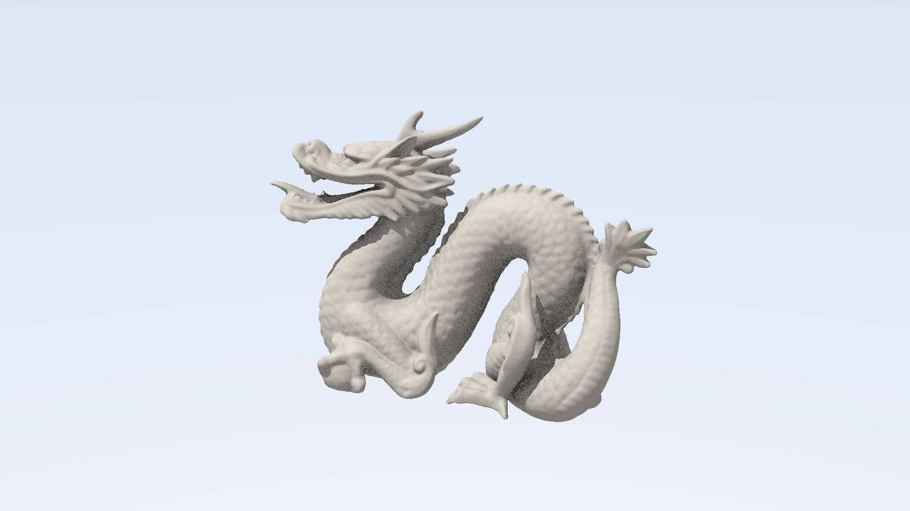

# BVH Ray Tracing of Large Triangle Meshes: Sequential CPU vs CUDA

Parallel Computing (CUDA) term project. Pitipol Tangcherdchar.

This project renders 3D-scanned triangle meshes with up to about a million triangles. Each pixel
casts one **primary ray**, one **shadow ray** toward a directional light, and *N* **ambient-occlusion
(AO) rays**. Each ray has to find its closest (or any) hit among all the triangles. A
**binned-SAH bounding volume hierarchy (BVH)** brings that down from O(T) to about O(log T) per
ray. The program compares a tuned single-threaded CPU baseline against four CUDA kernel versions
that all use the *same* BVH, camera, rays and random numbers, so their outputs can be checked
against each other pixel for pixel.



## Dataset

[Stanford 3D Scanning Repository](http://graphics.stanford.edu/data/3Dscanrep/):

| Model | File | Triangles | Format |
|---|---|---|---|
| Bunny | `bun_zipper.ply` | 69,451 | ASCII PLY |
| Dragon | `dragon_vrip.ply` | 871,414 | ASCII PLY |
| Happy Buddha | `happy_vrip.ply` | 1,087,716 | ASCII PLY |
| Lucy *(optional)* | `lucy.ply` | ~28M | binary PLY |

`graphics.stanford.edu` could not be reached from the development machine, so the download
script falls back to an unmodified copy of the original PLY files in the
[Harvey Mudd CS155 model archive](https://www.cs.hmc.edu/courses/2009/fall/cs155/archive/models/).
**Lucy is only on the Stanford server**, so as the plan allows, the largest model in the reported
results is the **Happy Buddha** (1.09M triangles). If you can reach Stanford, run the script with
`-Lucy` / `--lucy` and the benchmark script picks it up automatically (`--up z`). Lucy needs
about 1.8 GB of GPU memory and about 4 GB of host RAM.

A procedural sphere-on-ground scene (20K triangles) is built into the program for unit tests and
`--verify`, so neither needs a download.

## Requirements

| | Used for the reported results |
|---|---|
| GPU | NVIDIA GeForce RTX 2060 6 GB (Turing, sm_75, 30 SMs) |
| CUDA | 13.3 (any CUDA ≥ 11 should work; CUDA 13 needs sm_75 or newer) |
| Host compiler | MSVC 19.51 (Visual Studio 2026); GCC/Clang with C++17 on Linux |
| CMake | ≥ 3.24 (VS ships one), Ninja |
| CPU | Intel Core i7-9700F @ 3.0 GHz (baseline uses one core) |
| OS | Windows 10 Pro 22H2 |
| Plots | Python 3 + matplotlib (`py -m pip install matplotlib`) |

The only third-party code is `include/stb_image_write.h` (public domain, PNG output). There is
no OptiX, Embree or other ray-tracing library: the BVH, traversal and intersection code is all
hand-written.

## Build

The GPU architecture defaults to `native` (the GPU in the build machine). Override it with
`-DCMAKE_CUDA_ARCHITECTURES=75` (or 86, 89, …) when building for a different GPU.

**Windows** (finds Visual Studio, loads its x64 environment, then runs CMake + Ninja):

```powershell
powershell -ExecutionPolicy Bypass -File scripts\build.ps1
```

Manual build from a *x64 Native Tools* prompt:
`cmake -S . -B build -G Ninja -DCMAKE_BUILD_TYPE=Release` then `cmake --build build`.

**Linux:**

```bash
cmake -S . -B build -DCMAKE_BUILD_TYPE=Release && cmake --build build -j
```

The build produces `build/raytracer(.exe)` and `build/rt_tests(.exe)` (`ctest --test-dir build`
runs the unit tests).

## Download the data

```powershell
powershell -ExecutionPolicy Bypass -File scripts\download_data.ps1     # add -Lucy for Lucy
```
```bash
scripts/download_data.sh                                              # add --lucy for Lucy
```

The meshes go in `data/`, which Git ignores.

## Run

```bash
# One model, CPU baseline vs optimized GPU kernel, writes renders/dragon_<mode>.png
build/raytracer --model data/dragon_vrip.ply --width 1920 --height 1080 --ao 4 \
                --mode cpu,gpu_bvh_opt --out renders/dragon.png

# Every GPU kernel, 32x8 blocks, timings appended to a CSV
build/raytracer --model data/happy_vrip.ply --mode gpu_all --block 32x8 --csv results/mine.csv

# Correctness: unit tests + CPU vs every GPU kernel on the test scene, bunny and dragon
build/raytracer --verify
```

Modes are `cpu`, `gpu_brute`, `gpu_bvh_naive`, `gpu_bvh_opt` and `gpu_bvh_persistent`, plus
`gpu_all` (the four GPU modes) and `all`. Run `raytracer --help` for every option (camera
`--yaw/--pitch/--fov/--up`, `--ao-radius`, `--bins`, `--leaf`, `--runs`, `--warmup`,
`--validate`, …).

Each mode does 1 warm-up run and then reports the **median of 5** timed runs (`--warmup`,
`--runs`). The timings are:

* **CPU**: wall-clock time of the render loop (`std::chrono`).
* **GPU kernel**: `cudaEvent` time around the kernel launch(es) only.
* **GPU end to end**: wall time of device allocation + host-to-device upload of the BVH and
  triangles + kernel + device-to-host copy of the image + free.
* **BVH build**: timed on its own. It is shared by both versions and runs on the CPU.

"Mrays/s" uses the nominal ray count *W·H·(2 + AO)*.

### Benchmarks and plots

```powershell
powershell -ExecutionPolicy Bypass -File scripts\run_benchmarks.ps1   # ~10 min; -Quick for 1 run each
py scripts\plot_results.py
```
```bash
scripts/run_benchmarks.sh && python3 scripts/plot_results.py
```

These write `results/results.csv`, plus `results/plots/*.png` for the slides:

| Experiment (`experiment` column) | Setting |
|---|---|
| `size` | bunny, dragon, buddha (lucy) at 1920×1080, 4 AO |
| `ao` | dragon 1080p with 0, 1, 4, 16, 64 AO samples |
| `resolution` | dragon, 4 AO, 512², 1080p, 4K |
| `ablation` | naive / opt / persistent kernels on the dragon |
| `ablation_brute` | CPU and all four kernels on the bunny at 320×240 (brute force is far too slow for more) |
| `block` | 8×8, 16×16, 32×8, 32×32 blocks |

The CPU uses 3 timed runs instead of 5 for the heaviest settings (16/64 AO, 4K, and the size
sweep) to keep the script's run time reasonable. The GPU comparison is never reduced.
**Close games and other GPU-heavy programs before benchmarking.** On a shared GPU, kernel times
for the same setting vary by up to 4×.

## Design

### Sequential baseline (CPU), and why it is the best *sequential* version

1. **Custom PLY loader** (`src/ply_loader.cpp`) for ASCII, binary little- and big-endian files,
   with any element/property layout. Polygons are fan-triangulated.
2. **Binned SAH BVH** (`src/bvh_build.cpp`): 16 bins per axis (configurable up to 32), cost
   *C_trav + (A_L·N_L + A_R·N_R)/A*. A node becomes a leaf at ≤ 4 triangles when splitting is
   not cheaper. Depth is capped at 62 so the 64-entry traversal stack can never overflow.
   Build cost is O(T log T).
3. **Flattened depth-first layout**: 32-byte nodes (two `float4`s). The left child is always
   the next node, so only the right child index (or first triangle + count) is stored.
4. **Iterative ordered traversal** (`include/trace.h`): visits the nearer child first, keeps a
   stack of entry distances, and skips any subtree whose entry is beyond the current closest
   hit. Uses a precomputed reciprocal ray direction.
5. **Möller–Trumbore** on precomputed `v0, e1, e2` (48-byte triangles).
6. **Any-hit traversal** for shadow and AO rays, which stops at the first hit within `tMax`.
7. **Shading**: albedo × (0.7 · Lambert · shadow + 0.3 · (1 − occlusion)), with sqrt gamma.

Brute force costs O(P·T). The BVH gives O(P log T) + O(T log T) for the build, and SAH is the
standard measure of BVH quality (PBRT and the research literature). The CPU code is compiled
`/O2 /arch:AVX2` (or `-O3 -march=native`). The hot path avoids MSVC's out-of-line `fminf`
(swapping it for compare-select made both the CPU render and the BVH build about 6× faster). It
is single-threaded on purpose. "Best possible" here means the best known acceleration structure
with single-ray traversal tuned for one core. SIMD packet tracing and wide BVHs (BVH4/8) are
faster still, but they are a different algorithm.

### Parallel version (CPU builds, GPU traces)

* One thread per pixel (primary + shadow + N AO rays), 2D grid of 2D blocks (default 16×16).
* Per-thread traversal stack (64 entries) in local memory.
* Deterministic **PCG hash** RNG keyed by (pixel, sample, seed). AO directions use
  rejection-sampled cosine weighting (no `sin`/`cos`), so the CPU and GPU generate
  **bit-identical** rays.
* The ray, AABB, triangle, traversal and shading code is written once as `__host__ __device__`
  in `include/vecmath.h` and `include/trace.h`. The CPU and `gpu_bvh_opt` compile literally the
  same functions.

| Kernel | What it does | Targets |
|---|---|---|
| `gpu_brute` | each ray tests every triangle | shows that the algorithm matters, not only raw parallelism |
| `gpu_bvh_naive` | same BVH, but 40-byte array-of-structs nodes, indexed vertices (edges recomputed), plain loads, a division per slab test, fixed child order | GPU BVH baseline |
| `gpu_bvh_opt` | `float4`-aligned nodes/triangles via `__ldg`, precomputed inverse direction, nearer-child-first with distance culling | memory layout and access |
| `gpu_bvh_persistent` | `gpu_bvh_opt` traversal; launches just enough warps to fill the GPU (occupancy API), each warp pulls 8×4 pixel tiles from a global `atomicAdd` counter | load imbalance between background and dense-geometry pixels |

`gpu_brute` is split into strips of 8 rows per launch so that no single launch trips the
Windows display watchdog (TDR, ~2 s).

## Correctness

`raytracer --verify` runs:

* **Unit tests** (216 checks): ray–triangle (hit, miss, exact edge/vertex, parallel, behind),
  ray–AABB (zero direction components, `tMax` culling, origin inside, misses), BVH closest-hit and
  any-hit against brute force on 4000 random rays for three meshes and build settings, ASCII and
  binary PLY round trips, RNG determinism and cosine distribution, and the LBVH tests listed under
  [GPU BVH construction](#gpu-bvh-construction-lbvh-ploc-h-ploc-trbvh).
* **BVH validation**: every triangle appears in exactly one leaf, every node is reachable once,
  child boxes lie inside their parent, leaves contain their triangles, and depth fits the stack.
* **Hit-ID test**: the primary-ray triangle ID per pixel must match the CPU in ≥ 99.99 % of pixels.
* **Image test**: max absolute difference and PSNR (must be ≥ 40 dB). Fast-math is never used.

Equal-distance hits are broken by the smaller triangle index, so the result does not depend on
traversal order. The only remaining CPU/GPU difference is the GPU's fused multiply-add, which
changes a handful of pixels exactly on triangle edges.

Results at 640×480, 4 AO (RTX 2060, current build):

| Scene | Kernel | Hit-ID mismatches | Pixels differing | PSNR |
|---|---|---|---|---|
| test scene (20K) | all four | 0 / 307,200 | 1 | 67.2 dB |
| bunny (69K) | all four | 3 / 307,200 (0.0010 %) | 2 | 64.6 dB |
| dragon (871K) | naive, opt, persistent | 7 / 307,200 (0.0023 %) | 8 | 56.7 dB |

(An earlier build, used for the presentation slides, measured 1 / 2 / 5 mismatches. The
difference comes from code generation of the edge cases, not from the tree: the commit before the
LBVH work also gives 7 on the dragon.)

## Results

These numbers are from `scripts/run_benchmarks.ps1` on the hardware above, with a median of 5
GPU runs (3 CPU runs for heavy settings). Raw data is in `results/results.csv` and the charts
are in `results/plots/`. The desktop was still running light background programs, so repeated
GPU measurements of the *same* setting vary by about ±25 % (dragon 1080p / 4 AO measured
6.6–11.1 ms across experiments). Read small differences between kernels as noise.

**Speedup vs mesh size** (1080p, 4 AO; kernel time, speedup over the 1-thread CPU):

| Model | Triangles | BVH build | CPU | gpu_bvh_naive | gpu_bvh_opt | gpu_bvh_persistent | opt end to end |
|---|---|---|---|---|---|---|---|
| bunny | 69K | 0.06 s | 743 ms | 13.5 ms (55×) | 4.1 ms (182×) | 4.6 ms (161×) | 8.4 ms (88×) |
| dragon | 871K | 0.77 s | 974 ms | 28.0 ms (35×) | 6.7 ms (146×) | 6.6 ms (147×) | 23.0 ms (42×) |
| buddha | 1.09M | 0.92 s | 937 ms | 27.2 ms (34×) | 8.3 ms (113×) | 8.9 ms (105×) | 27.7 ms (34×) |

**Speedup vs workload** (dragon, 1080p, gpu_bvh_opt): 0 AO 92×, 1 AO 119×, 4 AO 88×,
16 AO 132×, 64 AO 101× (CPU 8.7 s vs GPU 87 ms for 145M rays).

**Speedup vs resolution** (dragon, 4 AO, gpu_bvh_opt): 512² 47×, 1080p 113×, 4K **145×**.
End to end, the speedup goes from 11× to 79×, because the fixed upload cost is amortized
over more pixels.

**Ablation** (dragon 1080p, 4 AO): naive 19.7 ms → opt 6.7 ms (**3.0×** from the memory layout
and access changes); persistent 6.6 ms (no measurable gain on Turing). On the bunny at 320×240,
**brute force takes 3.6 s against 0.48 ms with the BVH (7,500×)**. At that size the 1-thread CPU
with a BVH (38 ms) is about 100× faster than the GPU without one.

**Block size** (dragon, gpu_bvh_opt): 8×8 6.6 ms, 32×8 7.0 ms, 16×16 8.3 ms, 32×32 8.6 ms.
Narrow or small blocks win slightly because pixels close together in a block trace more
coherent paths.

**What the results say:**

* The GPU is **35–180× faster** than the sequential BVH code on every setting, and
  4 orders of magnitude faster than brute force on the same GPU.
* The gap **widens as the ray workload grows** (resolution: 47× → 145×), because the GPU
  needs many rays in flight to hide memory latency.
* The gap **narrows as the mesh grows** (182× → 113×). A BVH makes the CPU's cost only about
  log T, but on the GPU a bigger BVH overflows the 3 MB L2 cache, so traversal becomes
  memory-bound. End to end, the upload of ~80 MB of nodes and triangles also starts to matter.
* Persistent threads did not help: on modern GPUs the hardware block scheduler already balances
  cheap background pixels against expensive geometry pixels. (Aila & Laine's gains were on older
  architectures.)
* The BVH build on the CPU (0.8–0.9 s) takes **longer than the GPU render plus transfer** for
  the big models (see `time_breakdown.png`). That makes a GPU BVH build the obvious next step.

## GPU BVH construction (LBVH, PLOC, H-PLOC, TRBVH)

Follow-up to the presentation, in three steps:
- **`gpu-bvh-build-plan.md`, Goal 1:** build the BVH on the GPU with Karras's LBVH and state what
  it costs in tree quality.
- **Goal 2:** win the quality back with PLOC and TRBVH.
- **`bvh-builders-next-plan.md`:**
  - **Phase 0:** measurements that can resolve 5–20 % differences.
  - **Phase 1:** H-PLOC, PLOC-quality trees in a single kernel launch.

  PRBVH (Phase 2) and the PLOC++ stepping stone were not done (see
  [Limitations](#limitations-and-future-work)).

**Why.** With the CPU SAH build, the build is most of the time to the first image
(1080p, 4 AO, `gpu_bvh_opt`, end to end):

| Model | CPU SAH build | GPU render, end to end | Build share |
|---|---|---|---|
| bunny | 57 ms | 8.8 ms | 87 % |
| dragon | 771 ms | 25.6 ms | 97 % |
| buddha | 941 ms | 28.6 ms | 97 % |

The best builder minimises build + render:
- **Few rays per build** (previews, dynamic scenes, low sample counts) favour a fast builder.
- **Many rays per build** favour a high-quality one.
- **Incoherent motion** (explosions, particles, destruction) needs a full rebuild every frame,
  because refitting a fixed topology collapses in quality (measured below).

### Builders (`--build`)

| Builder | What it is |
|---|---|
| `cpu_sah` | the original binned SAH builder (16 bins): the CPU speed baseline |
| `cpu_sah_full` | **full-sweep SAH**: sorts the centroids on every axis at every node and evaluates every split, then the shared SAH collapse. O(n log² n); the **tree-quality reference (100 %)** |
| `cpu_lbvh` / `gpu_lbvh` | Karras 2012 LBVH; the GPU tree is **node-for-node identical** to the CPU one |
| `cpu_ploc` / `gpu_ploc` | PLOC, Meister & Bittner 2018; identical CPU and GPU trees |
| `cpu_hploc` / `gpu_hploc` | H-PLOC, Benthin et al. 2024: a **single kernel launch** on the GPU; identical flattened trees |
| `cpu_trbvh` / `gpu_trbvh` | LBVH + TRBVH treelet restructuring, Karras & Aila 2013; identical CPU and GPU trees |

The single-threaded `cpu_*` versions run the same algorithm and the same shared code, so each
build speedup comes from parallelism, not from a cheaper algorithm. All builders emit the same
flattened 32-byte node layout, so every render mode runs unchanged on any tree, and "which
builder" is the only variable in every experiment.

**Shared stages** (`src/gpu_build_common.cu`), one thread per element:

1. **Bounds**: triangle AABBs and centroids, then a hand-written min/max reduction (warp
   shuffles + shared memory, two passes) for the centroid bounds.
2. **Morton codes**: 63-bit (21 bits per axis), so even Lucy-sized meshes rarely produce
   duplicate keys. Reference code commonly uses 30-bit codes.
3. **Sort**: `cub::DeviceRadixSort::SortPairs` on (code, triangle index). It is stable, so
   equal codes keep index order exactly as the CPU's `(code, index)` sort does.
4. **Collapse + flatten** (after the builder-specific stages):
   - **Input:** every binary-tree builder produces one triangle per leaf.
   - **Leaf collapse:** bottom-up, each node gets an SAH cost,
     `min(C_trav·A + cost(left) + cost(right), C_isect·N·A if N ≤ 4)` with C_trav = 1.2 and
     C_isect = 1.0, and becomes a leaf when that is cheaper. `--collapse count` instead
     collapses every subtree with ≤ 4 triangles.
   - **Flatten:** each kept node finds its depth-first position by walking to the root, adding 1
     per level plus the left sibling's collapsed size whenever it comes from a right child. No
     global synchronisation is needed.
   - **Triangles** find their output slot the same way, so a subtree's triangles need not be
     contiguous in the builder's order. PLOC's, H-PLOC's and TRBVH's are not.

   The output depends only on the topology and child order, never on internal node ids, which
   is what makes the H-PLOC comparison below possible.

**LBVH** (`src/bvh_build_lbvh_gpu.cu`):

* **Hierarchy**: one thread per internal node finds its range and split (Karras 2012, Fig. 4).
  δ(i, j) = `clz(key_i ^ key_j)`; equal keys fall back to 64 + the common prefix of the indices.
* **Bottom-up fit**: one thread per leaf climbs; at each node it does `__threadfence()` and
  `atomicAdd` on an arrival counter. The first thread to arrive stops, the second unions the
  children (read with `__ldcg`, because the sibling may have been written on another SM) and
  computes the triangle count, SAH cost and collapsed size.
* `GpuLbvhBuilder` keeps its buffers between builds, builds from device-resident vertices, and
  can **refit** a finished tree (new positions, same topology) with the same atomic pattern.

**PLOC** (`src/bvh_build_ploc_gpu.cu`): clusters start as one triangle each, in Morton order.
Each iteration runs four data-parallel kernels over the current clusters:

1. **Nearest neighbour**: one thread per cluster searches the r clusters on each side for the
   one whose merged box has the smallest surface area. The block's clusters plus an r-wide halo
   on each side are staged in shared memory.
2. **Flags**: mutual nearest neighbours merge; the lower index creates the node. Each cluster
   packs `(creates a node) << 32 | (survives)` into one 64-bit value.
3. **Scan**: a hand-written exclusive scan of those values (warp-shuffle block scan, recursive
   scan of the block sums, add back: the Lab 6 pattern). The low half gives each survivor its
   new slot, the high half gives each new node its id, in creation order.
4. **Merge**: new internal nodes are written (box, children, triangle count, SAH cost), and
   survivors are scattered in order.

The CPU reads back one 8-byte total per iteration (the next cluster count).

**Determinism (PLOC and H-PLOC):** distances use round-to-nearest arithmetic with no
contraction, and ties are broken by a strict total order on pairs: (distance, index gap, parity
of the lower index, lower index, higher index). That has two consequences:
- The CPU and GPU agree bit for bit, and the globally closest pair is always mutual, so every
  iteration makes progress.
- On exact ties (identical boxes) neighbours pair up as (0,1), (2,3), …, so merging stays
  balanced. Without the gap and parity terms, 200 copies of one triangle built a chain 76 levels
  deep, deeper than the traversal stack. The unit tests caught this.

**H-PLOC** (`include/hploc.h`, `src/bvh_build_hploc_gpu.cu`): after the shared bounds,
Morton and sort stages, **one kernel launch** builds the whole binary hierarchy:

1. **Bottom-up range walk** (Apetrei 2014): one thread per leaf starts with the key range
   [k, k] and repeatedly moves to the parent. The parent's split is the neighbouring boundary
   with the longer common prefix (same δ and duplicate-key fallback as the LBVH). At the parent
   the thread does `atomicExch` of its outer boundary into the parent's slot: the first thread
   to arrive stops, the second gets the sibling's boundary and continues with the merged range.
   No thread ever waits on another, so there is no deadlock risk.
2. **Cluster lists**: every node carries the list of clusters (node ids) of its range, stored
   at the start of the range. The two children's lists are concatenated; the left list is
   already in place, so a thread whose combined list stays within the threshold just moves the
   right list up itself.
3. **Warp-level merge**: when a combined list exceeds the threshold (16, half a warp), the lanes
   that hold such nodes are served one at a time by the whole warp (`__ballot_sync` +
   `__shfl_sync`, the pattern of the warp TRBVH). The warp loads the ≤ 32 clusters into shared
   memory, one per lane, and runs PLOC iterations until the list is back to the threshold (1 at
   the root):
   - nearest neighbour within ±radius list positions;
   - mutual pairs merge, with new node ids from a global `atomicAdd`;
   - order-preserving compaction with `__ballot_sync` + `__popc`.

No per-iteration launches and no readbacks; the host reads the root id once. The CPU twin
(`src/bvh_build_hploc_cpu.cpp`) runs the same walk one leaf at a time with the same shared
code. Merge decisions depend only on a list's contents and order, so the topology is the same
in any processing order. Only the atomic node ids differ, and they don't affect the converter,
so the **flattened CPU and GPU trees are compared byte for byte**. That is the canonical
comparison the plan asked for, without a separate renumbering pass.

**TRBVH** (`include/trbvh.h`, passes in `src/bvh_build_lbvh_gpu.cu`): starting from the LBVH
with one triangle per leaf, each pass repeats the bottom-up climb. The second thread to reach a
node whose subtree has at least γ triangles restructures the **treelet** rooted there
(γ = 7, 14, 28 over the default 3 passes):

1. **Grow** the treelet: start from the node's children and repeatedly expand the treelet leaf
   with the largest surface area, up to 7 leaves.
2. **Dynamic program** over all 127 subsets of the leaves: `cost(S) = min(C_trav·A(S) + best
   split of S into two non-empty parts, C_isect·N(S)·A(S) if N(S) ≤ 4)`, 3^7 = 2,187 split
   evaluations per treelet.
3. **Rewire** the treelet's internal nodes (the root keeps its id) to the optimal topology.

On the GPU each treelet is processed by a **whole warp**, as in the paper:
- lanes that reach a treelet root are served one at a time;
- lane 0 grows the treelet;
- all 32 lanes fill the subset tables in shared memory and solve the subsets of each size in
  parallel;
- lane 0 rewires.

A one-thread-per-treelet version is kept behind `--trbvh-thread` for comparison. A final re-fit
recomputes the collapse decisions for the new topology.

### Measurement method (Phase 0)

GPU render times on this desktop vary a lot with background load: up to ±25 % between runs of
the same setting, while the quality gaps are 5–20 %. Quality renders therefore use
`--quality-bench`:

* **All trees first:** every builder's tree is built before any timing.
* **Warm-up:** the GPU renders for 3 s so its clocks settle.
* **Interleaving:** timed renders run round-robin (run 1 of every builder, then run 2, …), so
  slow drift affects every builder equally.
* **Statistics:** median of **11** runs and its interquartile range (`p25_ms` and `p75_ms`,
  appended to the render CSV).
* **Workload:** renders use **16 AO samples**, so the kernels run for 12–40 ms.

The clocks could not be locked: `nvidia-smi -lgc` needs administrator rights ("The current user
does not have permission to change clocks"). Even with all of the above, a few cells of the
final run have a 75th percentile 2–4× the median: something else competed for the GPU during
parts of the run. So **quality claims below rest on the SAH cost and the traversal counters,
which are deterministic**. Render times back them up through medians and the 1-thread CPU
render, which is far steadier. Two more Phase 0 changes:
- **Stronger reference:** a full-sweep SAH reference replaces binned SAH as 100 %.
- **Harder scene:** a mixed-size scene joins the uniform scans. Sponza and San Miguel from
  McGuire's archive would have needed a download, so the plan's procedural fallback is used
  (`--model mixed`, camera `--cam inside`):
  - 8 huge ground triangles;
  - the dragon;
  - the bunny at 0.08×, 0.6× and 1.6× the dragon's size;
  - 140 thin pillar boxes of random height.

  1.08 M triangles of very different sizes in total. The previous run's CSVs are kept in
  `results/v1/`.

### Running it

```bash
# Build-time benchmark: median per stage + tree quality, appended to results/build.csv
build/raytracer --model data/dragon_vrip.ply --build-bench --build cpu_sah_full,gpu_lbvh,gpu_ploc,gpu_hploc,gpu_trbvh --validate

# Interleaved render timing of several trees, median + IQR
build/raytracer --model data/dragon_vrip.ply --quality-bench --build cpu_sah,gpu_hploc,gpu_trbvh --mode gpu_bvh_opt --ao 16 --runs 11 --csv results/mine.csv

# The mixed-size scene from inside; H-PLOC with other parameters
build/raytracer --model mixed --cam inside --build gpu_hploc --hploc-radius 4 --hploc-threshold 8 --mode gpu_bvh_opt

# Exploding dragon: CPU SAH, GPU LBVH, PLOC, H-PLOC and TRBVH rebuilds and a refit, every frame
build/raytracer --model data/dragon_vrip.ply --dynamic --frames 60 --width 1280 --height 720 --out renders/explode.png

# Box/triangle tests per ray need the counting build (never use it for timing)
powershell -ExecutionPolicy Bypass -File scripts\build.ps1 -Stats
build-stats/raytracer --model data/dragon_vrip.ply --build gpu_hploc --mode gpu_bvh_opt

# Everything, then the charts
powershell -ExecutionPolicy Bypass -File scripts\run_build_benchmarks.ps1
py scripts\plot_build.py
```

### Correctness

* **Unit tests** (216 checks in total):
  - Morton expansion and bit order; δ with duplicate keys;
  - hand-checked hierarchies for n = 2, 3 and 4 identical keys, and the Karras tree against an
    independent top-down reference for 60 random sorted key sets with many duplicates
    (n = 2 … 2,233);
  - the PLOC tie-break and distance, and H-PLOC's bottom-up parent choice;
  - every builder against brute force on random rays;
  - every GPU builder equal to its CPU twin on 5–9 meshes each, including n = 1, 2, 3, 200
    identical triangles, H-PLOC threshold 1, and a mesh with every triangle duplicated.
* **`--verify`** on the test scene, bunny and dragon:
  - every tree passes structure validation;
  - each GPU tree equals its CPU twin byte for byte;
  - rendering any tree gives exactly the same per-pixel triangle IDs as the SAH tree (the
    closest hit does not depend on the BVH);
  - the device-resident render matches the host-copy render.
* **`compute-sanitizer`** `memcheck`, `racecheck`, `synccheck` and `initcheck` on all four GPU
  builders: 0 errors, 0 hazards, including the warp-shared TRBVH tables and the H-PLOC cluster
  lists.

### Results

**Build time**: median of 5 builds after a warm-up (`results/build.csv`; PLOC r = 8; H-PLOC
r = 8, threshold 16; TRBVH 3 passes, 7-leaf treelets, warp-cooperative). GPU times are
`cudaEvent` time of the build kernels; the mesh upload (1.5–14 ms) is extra.

| Model | CPU SAH (binned) | CPU full SAH | GPU LBVH | GPU PLOC | GPU H-PLOC | GPU TRBVH |
|---|---|---|---|---|---|---|
| bunny (69K) | 63.5 ms | 205 ms | 0.51 ms | 3.45 ms | **0.91 ms** | 7.5 ms |
| dragon (871K) | 758 ms | 3.73 s | 4.8 ms | 13.1 ms | **9.2 ms** | 46.8 ms |
| buddha (1.09M) | 955 ms | 4.65 s | 6.0 ms | 15.2 ms | **11.5 ms** | 58.3 ms |
| mixed (1.08M) | 1,116 ms | 5.67 s | 6.1 ms | 15.5 ms | **11.3 ms** | 58.1 ms |

On the big models the GPU builders are 160–180× (LBVH), 58–72× (PLOC), 80–100× (H-PLOC) and
16–19× (TRBVH) faster than the binned CPU SAH build, and 52–75× faster than their own
single-threaded versions (CPU H-PLOC: 45 / 669 / 801 / 847 ms).


**Quality**: SAH cost relative to the full-sweep SAH reference (`build_quality.png`; counters
from the `-Stats` build at 1080p, 16 AO):

| Model | binned SAH | LBVH | PLOC | H-PLOC | TRBVH | box tests / ray: full SAH, LBVH, PLOC, H-PLOC, TRBVH |
|---|---|---|---|---|---|---|
| bunny | 100.9 % | 118.9 % | 112.4 % | 111.2 % | 105.3 % | 34.3, 39.4, 40.1, 39.8, 36.1 |
| dragon | 101.3 % | 123.4 % | 112.1 % | 111.2 % | 106.6 % | 44.5, 54.2, 51.5, 50.4, 47.2 |
| buddha | 101.2 % | 129.9 % | 112.4 % | 112.7 % | 106.4 % | 44.7, 56.1, 52.0, 52.4, 47.6 |
| mixed | **111.1 %** | 182.3 % | 118.7 % | 121.8 % | **103.3 %** | 24.6, 45.3, 29.8, 29.5, 27.8 |

1-thread CPU render at 1080p, 16 AO (steadiest timing; medians, ms):

| Model | full SAH | binned SAH | LBVH | PLOC | H-PLOC | TRBVH |
|---|---|---|---|---|---|---|
| dragon | 2,697 | 2,660 | 3,117 | 2,917 | 2,946 | 2,825 |
| buddha | 2,504 | 2,484 | 3,106 | 2,955 | 2,980 | 2,670 |
| mixed | 4,839 | 4,875 | 7,360 | 5,826 | 5,582 | 5,550 |

* **The full-sweep reference** is only ~1 % better than binned SAH on the uniform scans, but
  **11 % better on the mixed scene**: binning hurts when triangle sizes vary.
* **TRBVH beats the binned CPU SAH builder on the mixed scene** (103 % vs 111 % of full SAH;
  27.8 vs 24.6 box tests per ray) while building 19× faster.
* The mixed scene separates the builders far more than the scans do. The LBVH is at 182 %: its
  box tests per ray nearly double, and it renders 52 % slower than the reference.
* **The quality order LBVH < PLOC ≈ H-PLOC < TRBVH < SAH holds on every model**, and the SAH cost
  predicts the box tests per ray and the CPU render times.
* On the procedural test scene (`--verify`), PLOC and H-PLOC are 11 % and TRBVH 14 % cheaper than
  binned SAH.
* The GPU render medians (`gpu_bvh_opt`, with IQR bars in the chart) follow the same order, but
  some cells' IQRs are wide (see the method above). That is why the counters and CPU times are
  the evidence here.


**H-PLOC vs PLOC** (`pareto.png`, `hploc_sweep.png`):
* **Faster everywhere:** 3.8× on the bunny and 1.3–1.4× on the big models (9.2 vs 13.1 ms on the
  dragon). Its clustering is a single launch: 4.9 ms on the dragon, against PLOC's 9.2 ms over
  68 iterations.
* **Same quality on the scans:** 111–113 % vs 112 %. On the mixed scene it is 3 % worse
  (122 % vs 119 %). Its merges only see clusters within one Morton subtree's list, so a big
  triangle cannot find a partner outside it.
* **So H-PLOC dominates PLOC** on the uniform scans and trades 3 % quality for 1.4× speed on the
  mixed scene.
* **Against the paper:** H-PLOC reports ≈ 15 % more total build time than LBVH. Here it takes
  1.8–1.9× the LBVH's time, for two reasons:
  - the warp-cooperative merging itself (4.9 ms vs LBVH's hierarchy + fit 1.4 ms);
  - a slower flatten (3.0 vs 1.9 ms): atomically assigned node ids scatter the parent pointers
    the converter walks.

  The paper's implementation also fuses the collapse into the build; that would remove the
  second cost.
* **Radius × threshold** (dragon): every setting is within 111–113 % of the reference, and
  r = 4 with threshold 16 is the fastest (6.2 ms). The defaults r = 8, threshold 16 give the
  best quality (111.2 %).

**Stages** (`build_stages.png`):
* GPU LBVH is dominated by the sort, the bottom-up fit and the collapse/flatten (1–2.4 ms each
  on the Buddha).
* GPU PLOC spends ~70 % of its time clustering (65 iterations on the Buddha).
* GPU H-PLOC spends ~55 % in its one clustering launch and ~30 % in the flatten.
* GPU TRBVH spends 92 % restructuring.

**PLOC radius** (`ploc_radius.png`, dragon, % of full SAH): r = 1 gives 118.7 % in 8.5 ms; r = 4–16
gives 112 % in 11–13 ms; larger radii only add build time (18.4 ms at r = 64).

**TRBVH passes** (`trbvh_passes.png`):
* The first pass does most of the work: 123.4 % → 109.4 % in 26 ms.
* Passes 2–4 reach 107.2, 106.6 and 106.5 %.
* 5-leaf treelets: 20 ms for 108.6 %.
* Warp cooperation is 10× faster than one thread per treelet (46.6 vs 470 ms) for the identical
  tree.

**Time to image** (`time_to_image.png`, dragon): build + transfers + render as a function of the
rays traced with one tree, from a linear fit to the interleaved AO sweep (0–64 samples, 1080p).
The binned SAH tree only beats the LBVH tree after **~5.2 G rays per build (~415 frames at 1080p,
4 AO)**, the H-PLOC tree after ~9.5 G (~760 frames) and the TRBVH tree after ~20 G (~1,600
frames).

**Dynamic scene** (`dynamic_refit_vs_rebuild.png`, `explode.gif`): the dragon explodes over 60
frames (1280×720, 4 AO); every triangle flies off in its own random direction. In this run the
machine was busier than in the previous one: the CPU SAH rebuild took 1.45 s per frame vs 1.0 s
before. Compare the rows with each other, not across runs.

| Per frame (update + render) | Mean time | Mean update | SAH cost, frame 0 → last |
|---|---|---|---|
| CPU SAH rebuild + upload | 1,489 ms | 1,448 ms | 57 → 169 |
| GPU LBVH rebuild | 29.8 ms | 7.6 ms | 70 → 180 |
| GPU H-PLOC rebuild | 32.2 ms | 11.4 ms | 63 → 184 |
| GPU PLOC rebuild | 38.4 ms | 17.8 ms | 64 → 184 |
| GPU TRBVH rebuild | 82.6 ms | 64.2 ms | 61 → 171 |
| GPU refit of the frame-0 LBVH | 24.4 s | 1.6 ms | 70 → 80,663 |

Refitting is the cheapest update, but under incoherent motion the old topology's boxes grow to
span the whole explosion: the SAH cost rises over 1,000-fold. Every GPU rebuild keeps the tree
close to SAH quality. Once the pieces are scattered, PLOC's and H-PLOC's advantage over the LBVH
disappears, while TRBVH stays within 1 % of the CPU SAH rebuild.

**The trade-off:**

* **GPU LBVH**: the fastest build by far; its tree is 19–30 % worse on the scans and 82 % worse on
  mixed sizes. Best for dynamic scenes and quick previews.
* **GPU H-PLOC**: 1.9× the LBVH's build time for PLOC quality (111–113 % on the scans); faster
  than PLOC everywhere. The best middle ground on uniform meshes.
* **GPU PLOC**: slightly better than H-PLOC on mixed sizes (119 % vs 122 %), but 1.4× slower to
  build.
* **GPU TRBVH**: 5–7 % above the full-sweep reference on the scans and **better than the binned
  CPU SAH builder on mixed sizes**, at ~16× the CPU SAH build's speed. Best when a tree serves
  many rays.
* The binned CPU SAH tree only pays for its 0.75–1.1 s build after several hundred to a few
  thousand full-HD frames with the same tree.

Lucy (28M triangles) was not available (only on the Stanford server, unreachable from here), so
the Buddha is the largest scanned model.

### References

* T. Karras. *Maximizing Parallelism in the Construction of BVHs, Octrees, and k-d Trees.*
  HPG 2012.
* T. Karras. *Thinking Parallel, Part III: Tree Construction on the GPU.* NVIDIA Developer Blog,
  2012.
* T. Karras, T. Aila. *Fast Parallel Construction of High-Quality Bounding Volume Hierarchies.*
  HPG 2013.
* D. Meister, J. Bittner. *Parallel Locally-Ordered Clustering for Bounding Volume Hierarchy
  Construction.* IEEE TVCG 2018.
* C. Benthin, D. Meister, J. Barczak, R. Mehalwal, J. Tsakok, A. Kensler. *H-PLOC: Hierarchical
  Parallel Locally-Ordered Clustering for Bounding Volume Hierarchy Construction.* Proc. ACM
  CGIT 7(3), 2024.
* C. Apetrei. *Fast and Simple Agglomerative LBVH Construction.* CGVC 2014.
* ToruNiina/lbvh (MIT), an LBVH implementation named in the plan as a read-only reference.

The kernels here were written from the papers and the plan's summaries. No code was taken from
any reference implementation, and none was consulted for H-PLOC.

## Repository layout

```
include/   vecmath.h (shared math, named so it never shadows <math.h>), trace.h (shared
           traversal + shading + optional traversal counters), bvh.h, mesh.h, camera.h, rng.h,
           ply_loader.h, render.h, builders.h (builder API, tree stats), morton.h (Morton
           codes, delta, Karras split), bvh_common.h (binary tree, SAH collapse, converter),
           ploc.h, hploc.h, trbvh.h (shared builder steps), animate.h
src/       main.cpp (CLI), ply_loader.cpp, bvh_build.cpp (binned SAH), bvh_build_sah_full.cpp,
           gpu_build_common.cu/.cuh (bounds, Morton, sort, scan, converter), LBVH:
           bvh_build_lbvh_cpu.cpp / _gpu.cu (+ TRBVH, refit), PLOC: bvh_build_ploc_cpu.cpp /
           _gpu.cu, H-PLOC: bvh_build_hploc_cpu.cpp / _gpu.cu, bvh_convert_cpu.cpp,
           builders.cpp, animate.cu, render_cpu.cpp, render_gpu.cu (all render kernels + launch
           code), camera.cpp, verify.cpp, image.cpp, mesh.cpp (+ procedural scenes)
tests/     unit-test runner (procedural meshes only)
scripts/   build.ps1 [-Stats], download_data.ps1/.sh, run_benchmarks.ps1/.sh, plot_results.py,
           run_build_benchmarks.ps1, plot_build.py
results/   results.csv, build.csv, build_render.csv, traversal.csv, dynamic.csv, v1/ (the
           previous run) and plots/
renders/   output images
```

## Limitations and future work

* ~~The BVH is built on the CPU~~: done with four GPU builders, see
  [GPU BVH construction](#gpu-bvh-construction-lbvh-ploc-h-ploc-trbvh).
* **Not done from the second plan:**
  - **PRBVH** (parallel reinsertion, Phase 2): no time before the presentation. It is the
    natural next step to push GPU trees to or past the full-sweep reference.
  - **PLOC++** (optional Phase 1a).
  - **A downloaded mixed-size scene** (Sponza / San Miguel): replaced by the procedural one.
* GPU H-PLOC is 1.9× the LBVH's build time instead of the paper's ≈ 1.15×. Fusing the SAH collapse
  into the build (as the paper does) and numbering nodes for locality would recover most of it.
* GPU TRBVH could go faster: lane 0 still grows and rewires each treelet alone, and the large
  subsets (6–7 leaves) are solved by one lane. Splitting their partitions across lanes, as the
  paper does, would cut the critical path further.
* GPU PLOC could stop reading back the cluster count every iteration, for example by running a
  fixed number of iterations between checks.
* Render timings on this shared desktop GPU stay noisy even with warm-up, interleaving and
  11 runs; locked clocks (administrator rights) or a dedicated machine would tighten them.
* Sorting AO rays by direction or octant would make traversal within a warp more coherent.
* Use Nsight Compute / `-DRT_PTXAS_VERBOSE=ON` to report register use, occupancy and local-memory
  traffic for the traversal stack.
